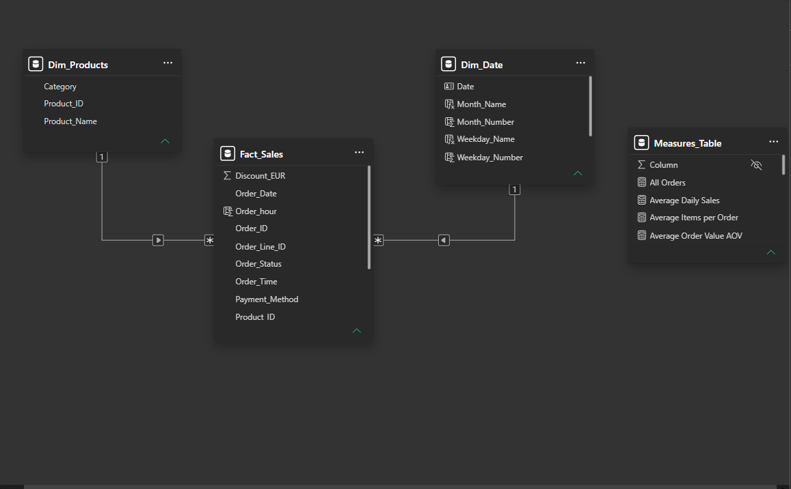
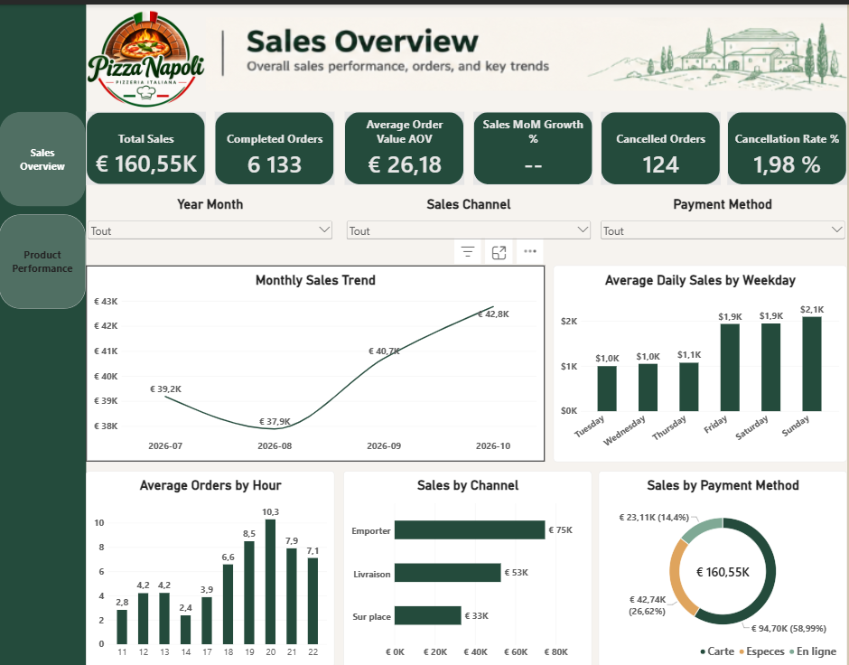
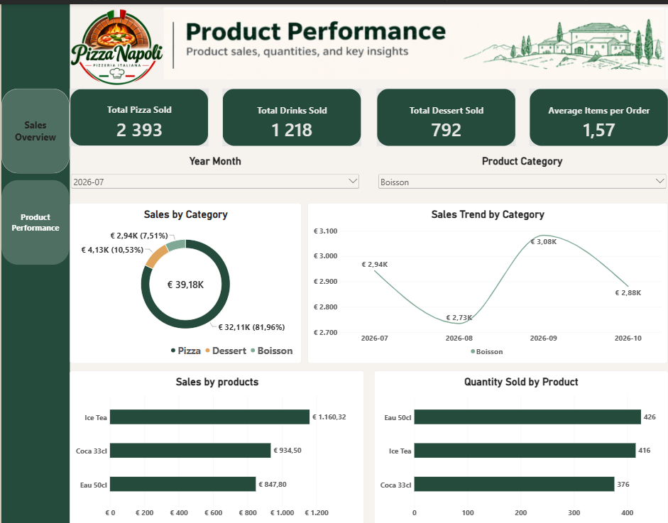

# 🍕 Pizza Napoli | Power BI Sales & Product Analytics

## Project Overview

Pizza Napoli is an end-to-end Business Intelligence project developed in Microsoft Power BI, based on a fictional Italian pizzeria.

The objective is to transform raw sales transactions into interactive dashboards that help business stakeholders monitor revenue, understand customer purchasing behavior, identify peak operating hours, and evaluate product performance.

The project covers **July to October 2026** and demonstrates practical skills in data preparation, dimensional modeling, DAX, and business reporting.

## Business Objectives

- Monitor revenue, completed orders, average order value, and cancellations.
- Identify peak operating hours and sales patterns across weekdays.
- Analyze revenue distribution by sales channel and payment method.
- Compare product categories and identify best-selling products.
- Track monthly sales performance and category trends.
- Support operational and commercial decision-making.

## Tools & Technologies

| Tool | Purpose |
|---|---|
| Power BI Desktop | Data modeling, DAX, interactive dashboards |
| Power Query | Data cleaning and transformation |
| DAX | Business measures and KPIs |
| CSV | Source data |
| GitHub | Project documentation and portfolio |

## Dataset

The project uses four fictional monthly CSV files:

- `Pizza_Napoli_Sales_2026_07.csv`
- `Pizza_Napoli_Sales_2026_08.csv`
- `Pizza_Napoli_Sales_2026_09.csv`
- `Pizza_Napoli_Sales_2026_10.csv`

The dataset contains approximately **14,252 transaction-line records**, including order dates, times, products, quantities, prices, discounts, sales channels, payment methods, and order statuses.

All data is fictional and used for educational and portfolio purposes.

## Data Preparation

Power Query was used to prepare the raw data for reporting.

Key activities included:

- Combining monthly CSV files into a consolidated dataset.
- Reviewing data types and correcting formatting issues.
- Checking duplicate order identifiers while preserving valid product-level order lines.
- Handling missing product identifiers.
- Distinguishing completed and cancelled orders.
- Preparing the data for dimensional modeling.

Only completed orders contribute to the main revenue and product-sales indicators.

## Data Model

The Power BI model follows a **star schema** with one fact table and two dimension tables.

**Fact_Sales**

Contains order-line transactions, including quantities, sales amounts, order dates and times, sales channels, payment methods, and order statuses.

**Dim_Products**

Contains product information, including product names and categories: Pizza, Boisson, and Dessert.

**Dim_Date**

Provides calendar attributes for time-based reporting, including year, month, year-month, and weekday.

### Data Model Screenshot



## Dashboard 1 — Sales Overview

This dashboard provides an overview of the pizzeria's commercial and operational performance.

### Key Performance Indicators

- Total Sales
- Completed Orders
- Average Order Value
- Monthly Sales Growth (%)
- Cancelled Orders
- Cancellation Rate (%)

### Visualizations

- **Monthly Sales Trend:** Revenue evolution over the reporting period.
- **Average Daily Sales by Weekday:** Average revenue generated on each weekday.
- **Average Orders by Hour:** Average completed orders per opening day, by hour.
- **Sales by Channel:** Revenue distribution across ordering channels.
- **Sales by Payment Method:** Revenue distribution across payment methods.

Interactive filters allow users to analyze selected months, sales channels, and payment methods.

### Dashboard Screenshot



## Dashboard 2 — Product Performance

This dashboard focuses on product sales, customer purchasing patterns, and category performance.

### Key Performance Indicators

- Total Pizzas Sold
- Total Drinks Sold
- Total Desserts Sold
- Average Items per Order

### Visualizations

- **Sales by Category:** Revenue contribution of each product category.
- **Sales Trend by Category:** Monthly revenue evolution for pizzas, drinks, and desserts.
- **Top Products by Sales:** Product ranking by revenue.
- **Quantity Sold by Product:** Product ranking by units sold.

Interactive filters allow users to analyze individual months and product categories.

### Dashboard Screenshot



## DAX Measures

The project includes reusable DAX measures for business reporting.

### Total Sales

```dax
Total Sales =
CALCULATE(
    SUM(Fact_Sales[Sales]),
    Fact_Sales[Order_Status] = "Completed"
)
```

### Completed Orders

```dax
Completed Orders =
CALCULATE(
    DISTINCTCOUNT(Fact_Sales[Order_ID]),
    Fact_Sales[Order_Status] = "Completed"
)
```

### Average Order Value

```dax
Average Order Value =
DIVIDE(
    [Total Sales],
    [Completed Orders]
)
```

### Average Items per Order

```dax
Average Items per Order =
DIVIDE(
    [Total Items Sold],
    [Completed Orders]
)
```

### Average Orders per Hour

```dax
Average Orders per Hour =
VAR OpeningDays =
    CALCULATE(
        DISTINCTCOUNT(Dim_Date[Date]),
        ALLSELECTED(Dim_Date),
        Dim_Date[Weekday_Number] <> 1
    )
RETURN
    DIVIDE([Completed Orders], OpeningDays)
```

This measure estimates average completed orders per opening day for each hour. The fictional pizzeria is assumed to be closed on Mondays.

## Business Insights

The dashboards enable several types of business analysis:

- Identify which products generate the most revenue versus those sold in the highest quantities.
- Understand the importance of pizza sales relative to drinks and desserts.
- Detect peak order hours to support staff scheduling.
- Compare average weekday revenue without being influenced by the number of occurrences of each weekday.
- Monitor cancellation rates and average order values.
- Evaluate monthly revenue trends across product categories.

## Project Structure

```text
Pizza-Napoli-PowerBI-Analytics/
├── data/
│   ├── Pizza_Napoli_Sales_2026_07.csv
│   ├── Pizza_Napoli_Sales_2026_08.csv
│   ├── Pizza_Napoli_Sales_2026_09.csv
│   └── Pizza_Napoli_Sales_2026_10.csv
├── screenshots/
│   ├── data_model.png
│   ├── product_performance.png
│   └── sales_overview.png
├── Pizza_Napoli.pbix
└── README.md
```

## How to Explore the Project

1. Download the `Pizza_Napoli.pbix` file.
2. Open it using Microsoft Power BI Desktop.
3. Explore the two interactive dashboard pages.
4. Use the available slicers to filter the results.
5. If refreshing the data, update the CSV folder source path in Power Query to match your local environment.

## Skills Demonstrated

**Power Query · Data Cleaning · Star Schema · Dimensional Modeling · DAX · Power BI · KPI Design · Data Visualization · Business Intelligence · Sales Analytics**

---

*Portfolio project developed to demonstrate practical Business Intelligence and Power BI reporting skills using fictional restaurant sales data.*
